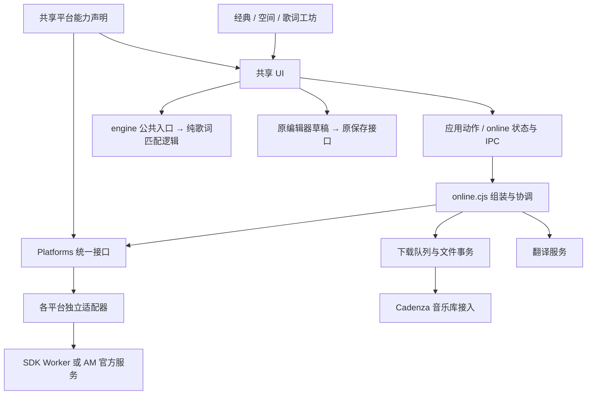

# Denza-Fork 架构与维护边界

## 维护关系

Cadenza 是主程序上游。Denza-Fork 自行维护在线音乐、下载、账号歌单、翻译和歌词匹配，后续需求直接在本仓库开发。Sonora、SyncC、LyricsFlow 是最初的参考来源，参考应用本身不构成运行、构建、发布或后续功能同步依赖；历史来源声明仍保留。另行接入的 LyricsFlow 公开 HTTP 音频服务是显式的文件来源，与参考应用的代码/版本同步分开维护。

平台 SDK 和翻译运行时直接跟踪各自的协议库/官方来源，不经由参考程序更新。`package.json` 的精确版本和 `package-lock.json` 是依赖版本依据；`docs/online-dependencies.json` 记录来源、适配模块与第三方源码指纹，不再重复保存一份 npm 版本号。

## 模块边界



| 模块 | 职责 | 不应依赖 |
| --- | --- | --- |
| `shared/online-providers.json` | 平台 ID、名称、登录方式、下载/歌词/远端播放能力与文案键，随桌面包发布 | SDK、密钥、Electron、UI 代码 |
| `electron/platforms.cjs` | 对应用提供 `search/login/account/logout/page/resolve/lyrics/lookup/open`，管理统一会话与分派 | 原始 SDK 字段及平台方法名、音乐库和界面 |
| `electron/online/providers/{netease,qq,kugou,apple}.cjs` | 单平台协议参数、结果映射、登录与分页行为 | Cadenza 音乐库、下载任务、翻译 UI、其他平台 |
| `electron/online/providers/helpers.cjs` | 统一歌曲/分页结果及下载直链校验 | 应用状态和播放器 |
| `electron/online/sdk-transport.cjs` | Worker 生命周期、取消/超时、常见协议错误解包 | UI、音乐库 |
| `electron/online/sdk-loaders.cjs` | Worker 中加载 SDK 的唯一位置 | 应用状态 |
| `electron/apple-music.cjs` | AM 官方窗口/专用会话、网络边界、API 与官方播放链接 | 下载队列、原音频解密、其他参考程序 |
| `electron/online/lyricsflow-audio.cjs` | AM 目录 ID / 格式到公开 HTTP 文件请求的映射 | Apple 登录凭据、音乐库、解密算法 |
| `electron/online/http-files.cjs` / `audio-validation.cjs` | 匿名流式传输、容器/codec/时长校验；桌面由 Electron 网络层提供文件传输 | 平台账号和 UI |
| `electron/downloads.cjs` | 并发任务、音频验证、暂存、提交与入库恢复，仅消费标准歌曲和 `resolve` 结果 | SDK 方法/包名、平台响应结构、界面 |
| `electron/online.cjs` | 主进程组装、受限 IPC、完整歌单快照、连接既有库 | SDK 调用与字段解析 |
| `electron/online/library-links.cjs` | 下载入库协调、平台身份与本地歌曲匹配、同步歌单数据 | 平台协议、UI、第三方 SDK |
| `electron/translation-service.cjs` | 翻译提供者、任务与输出验证 | 匹配 UI、音频容器 |
| `src/lyrics/translation.ts` | 纯歌词匹配与草稿合并，经 engine 公共入口使用 | 网络、IPC、平台 SDK、React |
| `src/app/online/state.ts` | 共享在线状态、订阅与桥接请求 | 播放器、具体界面 |
| `src/app/actions/online.ts` | 远端打开成功后暂停本地播放等应用协调 | 具体平台 ID、SDK、视图 |
| `src/app/ui/OnlineMusic.tsx` / `TranslationEditor.tsx` | 按共享能力显示统一入口，处理选择和草稿 | SDK 和主进程源码 |

适配器通过受限的 host 注入取得本平台协议调用；酷狗设备配置由主进程持久化。测试可注入假的 SDK 调用，而无需真实账号。应用层只接收标准 `OnlineSong`、歌单页、歌词文本和下载描述（URL、可选传输方式/期望格式/响应头超时）；临时取链 URL 不作为持久歌曲身份。

`openRemote` 是通用 IPC 操作，旧 `appleOpen` 仅保留为第一版草稿兼容入口。AM 官方浏览器播放仍不是 Cadenza 本地时钟的一部分，平台差异通过能力声明表达，不复制播放器。

## 跟进 Cadenza

1. 用户提出同步后，取得并阅读上游变更，记录待同步提交。`origin` 仍为 Denza-Fork，`upstream` 为 Cadenza。
2. 在独立工作分支合并上游提交，保留功能历史；不使用强制重置覆盖。Sonora/SyncC/LyricsFlow 的提交不参与这一流程。
3. 重点检查既有接入点：`main.cjs` / `preload.cjs`、`library.cjs` 的下载入库/同步歌单接口、`bridge.ts`、启动订阅，以及三处歌词编辑入口。Cadenza 若改变保存或播放器接口，在接入点适配，纯匹配算法和平台协议不随之改写。
4. 运行单元、类型、格式、构建和相关界面检查，更新验证记录，再提交可审阅的 PR。Windows、真实账号和实体音频行为按实际验证范围单独报告。

这些边界减少合并冲突，不能保证任何上游变更都无需适配。音乐库扩展逻辑已抽到 `online/library-links.cjs`，原文件保留扫描后关联、同步歌单写保护与导出入口；后续其他接入点是否进一步抽出，应依据实际变更，而不提前改造整个 Cadenza 核心。

## 独立更新 API / SDK

```sh
npm run online:deps          # 只读：版本、锁文件、安装结果、第三方源码指纹
npm run online:deps:check    # 另外向 npm 查询最新版本，不修改依赖或源码
```

版本查询失败会明确返回非零退出码。版本较新只表示存在候选更新，不表示已兼容。AM 网页协议和兼容翻译 HTTP 接口没有可固定的 SDK 版本，需要检查协议文档、真实匿名探测及对应契约用例。

更新单个 npm SDK：阅读该 SDK 自己的更新说明/许可证，选定确切版本，显式安装并审阅 `package.json`、锁文件与加载入口；响应字段或函数发生变化时只调整对应适配器，再通过契约用例和可用的真实接口检查。不使用参考程序的版本号作为更新依据，不批量执行不相关升级。

酷狗目前是固定的第三方源码快照：从 `docs/online-dependencies.json` 指定的直接来源选取提交/版本，记录确切来源和许可证，审阅后替换 `vendor/kugou`，更新依赖锁文件。`node scripts/online-deps.mjs --fingerprint` 仅打印新目录指纹，人工审阅后更新来源记录。指纹排除 `.git`、`node_modules`，不把本地安装产物当源码提交；`.gitattributes` 对此快照禁用换行转换，避免 Windows 检出时改变指纹。不要直接在 vendor 中积累 Denza 的业务修改；业务适配放在独立适配器。

新增平台时：补共享能力声明和 `MusicPlatform` 类型、独立适配器、注册工厂；需要 SDK 时在 Worker loader 添加加载入口和精确依赖，并补来源记录。用标准歌曲/歌单/歌词/取链契约测试验证，UI 按能力显示。需要新能力时显式扩展契约，不在共享 UI 中堆叠平台名称判断。

## 验证与持久化

`tests/unit/online-architecture.test.ts` 检查能力声明、打包清单、模块依赖边界，并以模拟协议响应验证三个 SDK 适配器的歌曲、歌单、音质、歌词和试听拒绝；AM 自身的账号与网络测试单独保留。界面与真实 Electron 测试验证接入点。模拟协议用例不能证明线上 SDK/账号可用。

本次模块调整不改变 `online.json`、同步歌单 `remote` 数据及下载任务格式，不重新命名歌曲或平台身份。以后改变持久化结构时，应增加显式版本和迁移，使用现有数据副本验证；不能靠重建用户资料库掩盖兼容问题。

AM 账号模块与文件服务适配互不调用：第三方服务只取得目录 ID、格式、模式及可选地区。`Downloads` 只消费通用下载描述与独立校验器；它没有 LyricsFlow URL、Apple 登录或服务端处理逻辑。设置页的共享用途提醒不是授权机制，不能据此推断第三方服务合法性。

## 第二版接入边界

- `electron/online/public-resolvers.cjs` 是匿名备用取链适配器，协议来源独立登记；由组装层注入 Platforms，不向 SDK 或前端扩散接口格式。解析成功后若文件失效，队列先在同档位请求备用来源，再降档。用户的偏好和实际档位分开保存。
- `electron/online/lyricsflow-audio.cjs` 统一 AM 链接目录展开、下载请求和歌词查询；账号令牌仍仅归 Apple 官方适配器管理。目录分页限定服务同源与当前地区，拒绝不完整的链接集合。
- `src/lyrics/download.ts` 仅包含原生格式读取与多轨合并，不合成 TTML，复用 Cadenza 的解析器。`scripts/online-lyrics.mjs` 将其构建为 `electron/generated/lyrics.cjs`；测试与应用构建自动生成，打包必须包含并检查该模块。不依赖参考应用的歌词实现。
- `electron/online/tags.cjs` 负责下载文件的容器字段，队列负责暂存、回读与事务。原编辑器/歌词保存路径不依赖这个模块。
- `CollectionCards.module.css` 与 `Cover` 共用 Cadenza 原卡片和封面表现；经典歌单和在线扩展使用同一组样式，空间通过已有共享在线面板访问，不复制业务。
- `online.json.preferences` 是可兼容的新增字段：各平台音质与全局歌词模式。任务保存入队时的歌词模式、请求档位、实际档位、来源与写入字段。旧数据加载补默认值，现有文件和歌单不迁移覆盖。

## 第三版接入边界

- `OnlineLyricsSearch.tsx` 是经典原在线匹配入口与空间歌词面板共用的完整歌词选择器；`SearchSongs` 提供预填、预览和结果回调。LRCLIB 原接口继续由既有库提供。完整歌词通过原 `useLyrics` 保存，不另起写盘路径。
- 平台 `lyrics` 契约提供 `original/translation/pronunciation/lrc/ttml`，`Platforms` 统一组合。`lyric-formats.cjs` 只处理 YRC/KRC 时间和语言轨，`qq-lyric-codec.cjs` 只处理在线 QQ 歌词文本编码。LRC-GET 格式辅助代码直接固定其来源提交、许可证和源码指纹；不含本地 QMC 音频处理或 AM 音频解密。
- 匹配编辑只替换明确识别的译文；对于无角色 LRC 的歧义附行宁可保留。清理空白行限制在用户应用匹配草稿的路径，不改变 Cadenza 对空时间戳/间奏的底层解析。
- 空间 `data.ts` 的同步歌单统计完整远端曲目，`world.ts` 在有原封面时复用原贴图缓存。`SpaceDetail` 的远端分支使用共享 `SyncedPlaylists` 固定歌单模式；本地分支保留原行为。
- `artwork.cjs` 负责匿名、有大小/时间限制的封面读取与重定向域名校验。`library-links.cjs` 合并同一歌单并发封面请求，写入前核对当前歌单身份和封面 URL；`library.cjs` 只注入原封面存储能力。API 与播放器均不依赖 3D 房间源码。


## 第四版场景与多轨排列边界

- `ui/OnlineSurface.ts` / `.module.css` 仅负责新增界面的模式样式，复用现有 kit 控件；经典的纸面/舞台浮层与空间的 `.card` 玻璃分开。下拉列表跨 portal 时携带对应样式，空间轻量模式保留同样的背景替代效果。
- 空间打开在线弹窗时继续绘制场景，使现有 `GlassPass` 能取得新增卡片的位置和大小；输入进入弹窗时释放指针并清除移动按键，弹窗键盘事件不交给场景。最小化和小窗仍暂停绘制。
- `space/playlistRoom.ts` 是不依赖渲染器的房间分类/分页模型，只读取 `space/data.ts` 的本地/在线标记。场景调用其选择、定位和更新方法；React 悬浮切换通过场景公开接口接入。平台 SDK 和持久音乐库结构不依赖分类 UI。
- `lyrics/download.ts` 在共享下载歌词格式入口按数值时间戳和明确轨道顺序合并 LRC；重复时间标记展开、同一时间/文本去重、逐字标记保留。在线 LRC 和 LRCLIB 预览/应用复用 `cleanBlankLyricRows` 清理空白整行；原生 TTML 原文不修改，无时间信息的歌词不编造时间戳。预览与保存使用同一完整 LRC。
