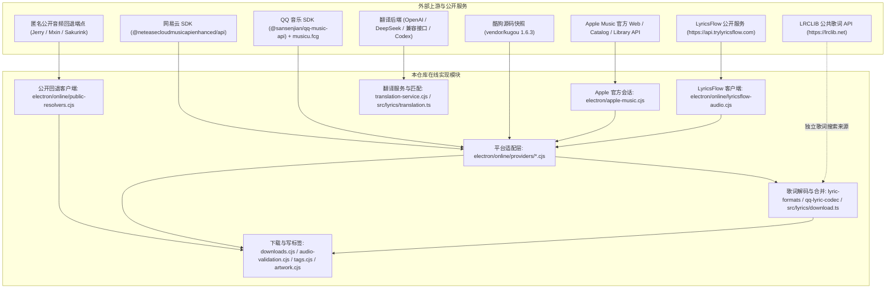
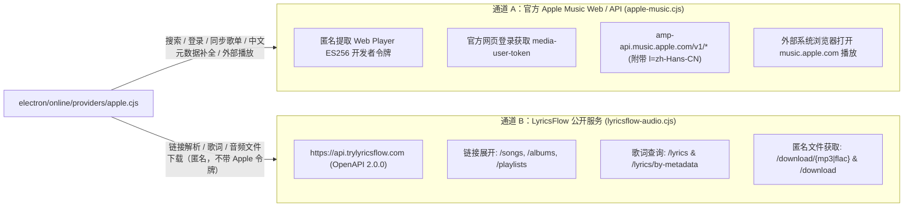

# Denza-Fork 在线 API 与关联功能参考文档

> **文档基线**：`Denza-Fork v3.2.9-denza.10`（`custom` 分支）  
> **文档性质**：本文档仅用于**客观整理和记录本仓库当前的在线 API、相关功能源码结构、外部协议细节及原规划方向**，供外部或新项目查阅参考。文中对本仓库现有实现的描述仅代表 Denza-Fork 当前代码状态，**不构成新项目的架构要求、接入规范或技术选型约束**。

---

## 1. 在线功能概览与模块分布

Denza-Fork 的在线部分涵盖四项核心能力：**多平台曲库/歌单与音频取链**（网易云、QQ 音乐、酷狗、Apple Music）、**下载与音频标签处理**、**在线歌词检索与多轨格式化**，以及**在线歌词翻译**。

> **核心事实边界**：
> - **程序本身不涉及任何音频或 DRM 解密**：本仓库仅作为协议客户端，不包含 FairPlay 解密、Widevine CDM、密钥提取或任何受保护音频格式（QMC/NCM/KGM/M4P 等）的本地解密逻辑。
> - **Apple Music 文件与歌词来源**：当前 Apple Music 的公开链接展开、歌词查询与文件下载来自 **`https://api.trylyricsflow.com/`** 的公开 OpenAPI 与文件服务，Apple 账号凭据不向该服务传递。
> - 仓库中的 `electron/online/qq-lyric-codec.cjs`（及 `electron/online/vendor/lrc-get/des-helper.cjs`）仅用于解包 QQ 音乐公开的 QRC 歌词文本编码，不涉及账号密钥或音频内容解密。

---

## 2. 项目在线相关文件索引

以下按目录与职责整理本仓库中所有与在线 API 及关联功能直接相关的文件，便于查阅源码。

### 2.1 依赖清单、能力配置与构建脚本

| 文件路径 | 当前作用 |
| --- | --- |
| `shared/online-providers.json` | 记录四个平台（`netease`/`qq`/`kugou`/`apple`）的基本信息、登录方式、功能开关及 Apple 格式档位标签。 |
| `docs/online-dependencies.json` | 登记全部 11 项在线上游依赖（npm 包、vendor 快照、公开 HTTP 协议、第三方源码片段）的仓库或文档地址与 SHA-256 指纹。 |
| `scripts/online-deps.mjs` | 核对 `package.json`、`package-lock.json` 与本地 vendor/源码指纹的只读检查脚本。 |
| `scripts/online-lyrics.mjs` | 将 `src/lyrics/download.ts` 编译为 `electron/generated/lyrics.cjs`，供主进程复用同一份多轨歌词合并逻辑。 |

### 2.2 平台适配、SDK 加载与协议客户端

| 文件路径 | 当前作用 |
| --- | --- |
| `electron/platforms.cjs` | 聚合四个平台适配器，向上暴露搜索、登录、歌单分页、音频取链、链接展开与歌词获取接口。 |
| `electron/online/sdk-transport.cjs` | 封装 Node.js `worker_threads` 池（按平台复用、超时控制与协议错误解包）。 |
| `electron/platform-worker.cjs` | Worker 线程脚本，负责懒加载 SDK、代理环境变量传递与错误消息脱敏。 |
| `electron/online/sdk-loaders.cjs` | 集中导入三家平台 SDK（`@neteasecloudmusicapienhanced/api`、`@sansenjian/qq-music-api/services`、`kugoumusicapi`）。 |
| `electron/online/providers/index.cjs` | 按平台清单装配四平台适配器。 |
| `electron/online/providers/helpers.cjs` | 通用字段提取、封面 URL 规范化、曲目/分页结构归一化以及直链试听片段过滤。 |
| `electron/online/providers/netease.cjs` | 网易云音乐协议适配实现。 |
| `electron/online/providers/qq.cjs` | QQ 音乐协议适配实现（含 `musicu.fcg` 歌词直连路径）。 |
| `electron/online/providers/kugou.cjs` | 酷狗音乐协议适配实现（含设备 `dfid` 注册与私有/公开歌单分页回退）。 |
| `electron/online/providers/apple.cjs` | Apple Music 编排实现，组合官方会话客户端与 LyricsFlow 公开服务客户端。 |
| `electron/apple-music.cjs` | Apple Music 官方 Web / Catalog / Library 客户端（独立会话、匿名开发者令牌提取、简体中文元数据补全、官方页面跳转）。 |
| `electron/online/lyricsflow-audio.cjs` | 对接 `https://api.trylyricsflow.com` 公开 OpenAPI 的客户端（链接解析、歌词查询、音频文件下载 URL 构造）。 |
| `electron/online/public-resolvers.cjs` | 非 Apple 平台的匿名公开音频回退客户端（`JerryMusicAPI` / `Mxin` / `Sakurink`）。 |
| `vendor/kugou/` | 固定的第三方源码快照（`MakcRe/KuGouMusicApi` `1.6.3`，内含 2 个 `.wasm` 签名模块）。 |

### 2.3 下载、校验、写标签与通用网络工具

| 文件路径 | 当前作用 |
| --- | --- |
| `electron/downloads.cjs` | 下载任务队列、并发调度、同档回退与降档逻辑、音频头检测及原子落盘提交。 |
| `electron/online/http-files.cjs` | 匿名流式音频下载传输（处理重定向、禁止 HTTPS 降级、不带认证头）。 |
| `electron/online/json-client.cjs` | 通用匿名 JSON 请求器（超时与响应体大小上限控制）。 |
| `electron/online/audio-validation.cjs` | 按预期音频格式校验下载文件的扩展名、实际编码与完整时长。 |
| `electron/online/artwork.cjs` | 匿名封面下载与内存 LRU 缓存（含音乐 CDN 域名校验与并发去重）。 |
| `electron/online/tags.cjs` | 使用 `node-taglib-sharp` 写入基础标签、封面、标准 LRC 与容器专属 TTML 字段，并配合 `music-metadata` 回读验证。 |
| `electron/online/tag-worker.cjs` | 独立 Worker 线程，负责暂存副本写标签、回读校验与 SHA-256 摘要计算。 |

### 2.4 歌词处理、翻译服务与协调/界面源码

| 文件路径 | 当前作用 |
| --- | --- |
| `electron/online/lyric-formats.cjs` | 网易云 YRC、酷狗 KRC 逐字时间及酷狗 Base64 语言轨到增强 LRC 的格式映射。 |
| `electron/online/qq-lyric-codec.cjs` | QQ 音乐十六进制 QRC 歌词文本解包与增强 LRC 转换。 |
| `electron/online/vendor/lrc-get/` | 引自 `valenbine/LRC-GET`（MIT，commit `2cc0e67d`）的 QRC 文本解包辅助代码 `des-helper.cjs`。 |
| `src/lyrics/download.ts` | 多轨 LRC 时间轴交错合并与原生 TTML 透传逻辑（编译产物位于 `electron/generated/lyrics.cjs`）。 |
| `src/lyrics/translation.ts` | 译文草稿行抽取、空行清理、粘贴译文匹配与无损合并（保留读音附行）。 |
| `electron/translation-service.cjs` | 在线歌词翻译后端（OpenAI Responses/Chat、DeepSeek、OpenAI 兼容接口、`@openai/codex` app-server 文本模式）。 |
| `electron/online.cjs` / `electron/online-store.cjs` / `electron/preload.cjs` | 本仓库桌面端主进程组装、凭据加密存储与歌单同步入口。 |
| `electron/online/library-links.cjs` / `electron/library.cjs` | 本仓库本地曲库与同步歌单的关联实现；`library.cjs` 第 846–921 行包含既有 `LRCLIB` 歌词查询实现。 |
| `src/app/bridge.ts` / `src/app/online/{types,state,words}.ts` / `src/app/actions/online.ts` | 前端在线类型定义、状态同步与远端播放协调。 |
| `src/app/ui/OnlineMusic.tsx` / `OnlineLyricsSearch.tsx` / `TranslationEditor.tsx` / `PlatformArtwork.tsx` | 在线搜索、下载队列、账号管理、多源歌词选择与翻译编辑界面源码。 |
| `tests/unit/online*.test.ts` / `apple-music.test.ts` / `lyricsflow-audio.test.ts` | 各平台适配器、Apple 会话、LyricsFlow 客户端、下载校验与歌词匹配的单元测试参考样例。 |

---

## 3. 当前使用的在线平台 API 与协议明细

### 3.1 上游依赖与协议来源总表

| 标识 | 类型 | 当前版本 / 指纹 | 上游来源 | 许可 | 本仓库对应文件 |
| --- | --- | --- | --- | --- | --- |
| `@neteasecloudmusicapienhanced/api` | npm | `4.41.1` | `https://github.com/NeteaseCloudMusicApiEnhanced/api-enhanced` | MIT | `electron/online/providers/netease.cjs` |
| `@sansenjian/qq-music-api` | npm | `2.6.0` | `https://github.com/sansenjian/qq-music-api` | MIT | `electron/online/providers/qq.cjs` |
| `kugoumusicapi` | vendor | `1.6.3` (`vendor/kugou`) | `https://github.com/MakcRe/KuGouMusicApi` | MIT | `electron/online/providers/kugou.cjs` |
| `lrc-get-online-lyric-helper` | source | commit `2cc0e67d` (`src/des-helper.js`) | `https://github.com/valenbine/LRC-GET` | MIT | `electron/online/qq-lyric-codec.cjs` |
| `apple-web` | protocol | 无固定版本 | Apple Music API / Web Player | 官方服务 | `electron/apple-music.cjs` |
| `lyricsflow-file-service` | protocol | OpenAPI 观测 `2.0.0` | `https://api.trylyricsflow.com/openapi.json` | 第三方公开服务 | `electron/online/lyricsflow-audio.cjs` |
| `jerry-music` | protocol | 无固定版本 | `https://music-api.jerrynis.com` | 第三方公开服务 | `electron/online/public-resolvers.cjs` |
| `mxin-music` | protocol | 无固定版本 | `https://api.mxin.me` | 第三方公开服务 | `electron/online/public-resolvers.cjs` |
| `sakurink-meting` | protocol | 无固定版本 | `https://apivc-meting.sakurink.eu.org/registration/` | 第三方公开服务 | `electron/online/public-resolvers.cjs` |
| `@openai/codex` | npm | `0.169.0` | `https://github.com/openai/codex` | Apache-2.0 | `electron/translation-service.cjs` |
| `translation-http` | protocol | OpenAI Responses/Chat | `https://platform.openai.com/docs/api-reference` | 兼容协议 | `electron/translation-service.cjs` |

> 在本仓库的 Node.js 实现中，网易云、QQ、酷狗三家 SDK 通过 `electron/online/sdk-transport.cjs` 与 `electron/platform-worker.cjs` 隔离在 `worker_threads` 中执行（空闲 60s 回收、单请求 25s 超时、连续 4 次挂起重建），并由 `unwrap()` 统一处理各 SDK 的业务错误码。

### 3.2 网易云音乐（`netease.cjs`）

- **上游库**：`@neteasecloudmusicapienhanced/api` (`4.41.1`)。
- **使用到的接口**：
  - 搜索：`cloudsearch`（`type: 1, limit: 30`）。
  - 登录与校验：`login_qr_key`（生成 `https://music.163.com/login?codekey=<key>` 二维码）→ `login_qr_check`（`800` 过期、`803` 完成）；凭据校验走 `login_status`。
  - 歌单与曲目：`user_playlist`、`playlist_track_all`（每页 100）。
  - 音频取链：优先 `song_url_v1`（档位映射 `standard` / `exhigh` / `lossless` / `hires`），失败回退 `song_download_url`（码率映射 `128000` / `320000` / `999000` / `1999000`），并过滤 `freeTrialInfo` 试听片段。
  - 歌词：优先 `lyric_new`（读取 `yrc.lyric` 逐字、`ytlrc`/`tlyric` 译文、`yromalrc`/`romalrc` 罗马音），无结果回退 `lyric`。

### 3.3 QQ 音乐（`qq.cjs`）

- **上游库与直连端点**：`@sansenjian/qq-music-api` (`2.6.0`) + 直接 HTTP POST `https://u.y.qq.com/cgi-bin/musicu.fcg`（歌词快路径）。
- **使用到的接口**：
  - 搜索：`getSearchByKey`（`t: 0, n: 30`）。
  - 登录与校验：`getQQLoginQr` / `checkQQLoginQr`；校验走 `getUserDetail`。
  - 歌单与曲目：`getUserPlaylists`、`songListDetail`（每页 100）。
  - 音频取链：`getMusicPlay`（`128` / `320` / `flac`，请求头附带 `Referer: https://y.qq.com/`）。原生 `hires` 档位当前直接抛出不可用。
  - 歌词（两级回退）：
    1. 直接匿名 POST `https://u.y.qq.com/cgi-bin/musicu.fcg`，调用模块 `music.musichallSong.PlayLyricInfo` / 方法 `GetPlayLyricInfo`（传入 `songMID`、`songID`、`trans: 1`、`roma: 1`），返回的十六进制编码内容经 `qq-lyric-codec.cjs`（3DES 公开常量解包 + zlib inflate）还原为 QRC/LRC；
    2. 直连无主歌词时回退 SDK `getLyric`，并通过 `decodeText` 兼容 Base64 编码响应。

### 3.4 酷狗音乐（`kugou.cjs`）

- **上游来源**：`vendor/kugou`（`MakcRe/KuGouMusicApi` `1.6.3` 快照）。
- **设备初始化**：首次调用前生成随机 `KUGOU_API_MID`/`KUGOU_API_GUID` 并调用 `register_dev` 获取设备 `dfid`，后续作为 Cookie 字段随请求携带。
- **使用到的接口**：
  - 搜索：`search`（`type: 'song', pagesize: 30`）。
  - 登录与校验：`login_qr_key`（生成 `https://h5.kugou.com/apps/loginQRCode/html/index.html?appid=1005&qrcode=<key>` 二维码）→ `login_qr_check`（`status: 0` 过期、`4` 完成）；校验走 `user_detail`。
  - 歌单与曲目：`user_playlist` 同步记录 `listid` 与 `global_collection_id`；拉取曲目优先 `playlist_track_all_new`，失败且存在对应 `global_collection_id` 时回退 `playlist_track_all`。
  - 音频取链：`song_url`（传入 `hash`、`album_id`、`album_audio_id`，档位映射 `128` / `320` / `flac` / `high`，显式传 `free_part: 0`）。
  - 歌词：`search_lyric` 取首个候选 → 优先 `lyric(fmt: 'krc', decode: true)` 解析逐字时间及内嵌 Base64 `[language:...]` 译文/音译轨 → 失败回退 `lyric(fmt: 'lrc', decode: true)`。

### 3.5 Apple Music 双轨机制与非解密说明（重点）

当前 Apple Music 拆分为两条完全独立、互不共享凭据的通道：

#### 通道 A：官方 Apple Music Web / Catalog / Library（`electron/apple-music.cjs`）

- **匿名开发者令牌**：请求 `https://music.apple.com/us/browse` 定位前端脚本 `/assets/index~*.js`，从中提取有效 ES256 JWT（优先 `kid === 'WebPlayKid'`）并按过期时间缓存。
- **账号授权与隔离**：在独立无特权浏览器会话中打开官方域名白名单（`music.apple.com`、`appleid.apple.com`、`idmsa.apple.com`、`account.apple.com`），读取 `media-user-token` 并请求 `/v1/me/storefront` 验证账号与地区。
- **API 能力与元数据语言**：
  - 搜索：`/v1/catalog/{storefront}/search?types=songs&limit=30&offset=...&term=...`
  - 歌单同步：`/v1/me/library/playlists` 与 `/v1/me/library/playlists/{id}/tracks?limit=100&include=catalog`
  - 链接元数据本地化：`localizeSongs()` 按地区分组、每批最多 100 个 ID 匿名请求 `/v1/catalog/{sf}/songs?ids=...`（总限时 15s，失败不阻断已展开的曲目列表）
  - 所有 `/v1/` 请求均附加 `l=zh-Hans-CN` 与 `Accept-Language: zh-CN,zh;q=0.9`，但不更改账号原有 `storefront`。
- **远端播放**：受保护流媒体不在本地解码播放，直接交由系统浏览器打开 `https://music.apple.com/{storefront}/...`。

#### 通道 B：LyricsFlow 公开 OpenAPI 与文件服务（`electron/online/lyricsflow-audio.cjs`）

- **服务来源**：指向 **`https://api.trylyricsflow.com/`**，接口依据其公开 OpenAPI 文档 **`https://api.trylyricsflow.com/openapi.json`**（当前观测版本 **`2.0.0`**）对接，全程匿名请求（`credentials: 'omit'`）。
- **接口映射明细**：
  1. **链接展开（`lookup`）**：解析 `music.apple.com` 的单曲、专辑、公开歌单链接或纯数字目录 ID，请求 `/songs/{id}`、`/albums/{id}` 或 `/playlists/{id}`（`?storefront=<sf>`），同源分页拉取曲目（单集合上限 2000 首）。
  2. **歌词查询（`lyrics`）**：优先请求 `/lyrics?song=<catalogId>&storefront=<sf>`；若失败或为空且具备歌曲信息，则回退 `/lyrics/by-metadata?title=...&artist=...&album=...&duration_ms=...&storefront=<sf>`。若返回为原生 TTML（`/<tt[\s>]/i`）则原样保留，并提取其中附带的译文轨。
  3. **音频文件获取（`resolve`）**：四档格式分别映射到公开 HTTP 下载端点：
     - `mp3`：`/download/mp3?song=<catalogId>&mode=apple`
     - `flac`：`/download/flac?song=<catalogId>&mode=apple`
     - `aac`：`/download?url=<songURL>&mode=gamdl&codec=aac&fallback=false&storefront=<sf>`（无 `sourceURL` 时改用 `song=<catalogId>`）
     - `alac`：`/download?url=<songURL>&mode=gamdl&codec=alac&fallback=false&storefront=<sf>`
     - 响应头等待超时放宽至 180s（供远端服务准备文件），收到文件后按目标格式核验实际容器、codec 与完整时长。

> [!IMPORTANT]
> **非解密事实声明**
> 1. **程序本身不涉及任何音频或 DRM 解密**：客户端没有任何 FairPlay 解密算法、密钥提取逻辑或本地解密工具。请求 URL 中的 `mode=gamdl` 仅为 `https://api.trylyricsflow.com/` OpenAPI 定义的服务端查询参数，客户端只负责发起匿名 HTTP GET 请求、接收普通音频文件流并校验完整性。
> 2. **凭据不外传**：Apple 的 `media-user-token` 与网页会话仅用于通道 A 的官方接口，永远不会发往 `api.trylyricsflow.com`。
> 3. 无 Apple Catalog ID 的用户自上传资料库曲目无法通过该目录接口下载。

### 3.6 当前非 Apple 平台的匿名公开回退端点（`public-resolvers.cjs`）

本仓库中，对于非 Apple 平台（网易云 / QQ / 酷狗），当原生 SDK 取链失败或下载结果校验不通过时，会按以下顺序匿名尝试公开 HTTP 端点（不携带任何账号凭据，仅传平台标识、歌曲 ID 与目标码率）：

1. **JerryMusicAPI**（仅网易云）：`https://music-api.jerrynis.com/api/song/url/v1?id=<id>&level=<standard|exhigh|lossless|hires>`
2. **Mxin**：`https://api.mxin.me/api/v1/music?server=<platform>&type=url&id=<id>&bitrate=<128|320|999|1999>`
3. **Sakurink**：`https://apivc-meting.sakurink.eu.org/registration/?server=<platform>&type=url&id=<id>&br=<128|320|999|1999>`（通过 HTTP 重定向获取音频直链）

---

## 4. 在线关联功能的当前处理逻辑

### 4.1 音频完整性校验、封面缓存与容器标签写入

- **音频流校验（`downloads.cjs` / `audio-validation.cjs`）**：
  - 通过文件头魔数识别真实容器：`fLaC`（FLAC）、ADTS 帧（AAC）、`ID3`/帧同步（MP3）、`ftyp`（M4A）、`OggS`（OGG）、`RIFF+WAVE`（WAV）；
  - 使用 `music-metadata` 解析实际编码、采样率、位深、码率与时长，拦截残缺文件或试听片段（例如目标时长 >60s 但实测短于元数据 15s 以上，或与 `expectedFormat` 指定的编码/时长不符）。
- **封面下载与缓存（`artwork.cjs`）**：限制 HTTPS、单图上限 8 MB、12s 超时与音乐 CDN 域名白名单，使用 64 条 / 64 MB 内存 LRU 缓存避免重复拉取。
- **元数据与双格式歌词内嵌（`tags.cjs` / `tag-worker.cjs`）**：
  - 使用 `node-taglib-sharp` 写入标题、艺人、专辑、封面与歌词；
  - 常规 LRC 写入各容器标准歌词字段；原生 TTML 按容器写入专用扩展字段：**FLAC/OGG/OPUS** 写入 Xiph `TTML`、**MP3** 写入 ID3v2 `TXXX:TTML`、**M4A** 写入 `com.apple.iTunes:TTML`；
  - 写标签在暂存副本上完成并用 `music-metadata` 回读核对字段存在且时长漂移 ≤0.05s；若写入或校验失败则丢弃副本、保留原始音频。

### 4.2 多轨歌词解析与 LRCLIB 现状

- **逐字歌词格式归一（`lyric-formats.cjs` / `qq-lyric-codec.cjs`）**：将网易云 YRC、QQ 音乐 QRC、酷狗 KRC 的逐字时间戳统一转换为增强 LRC 语法（`[mm:ss.xxx]<mm:ss.xxx>词`），并提取各平台自带的译文与音译/罗马音轨。
- **多轨合并与 TTML 保真（`src/lyrics/download.ts`）**：
  - 仅在来源本身提供真实 `<tt ...>` 文档时保留 `ttml`，不把逐行或逐字 LRC 伪造包装成 TTML；
  - 合并多轨 LRC 时按数值时间戳排序，同时间戳按 **原词 → 译文 → 读音** 排列并去重，同时清理空白行与 `//` 占位行（`cleanBlankLyricRows`）。
- **LRCLIB 现状（`electron/library.cjs` / `OnlineLyricsSearch.tsx`）**：
  - 本仓库继承自 Cadenza 的 `electron/library.cjs` 已对接 **`https://lrclib.net/api/get`**（精确匹配曲名/歌手/专辑/时长）与 **`https://lrclib.net/api/search`**（结构化与自由文本查询），目前仅作为歌词搜索弹窗中的独立切换源使用，尚未纳入自动下载内嵌歌词链路。

### 4.3 在线歌词翻译与匹配（`translation-service.cjs` / `src/lyrics/translation.ts`）

- **支持的模型后端**：OpenAI（`responses` / `chat` 协议）、DeepSeek、任意 HTTPS/本机 OpenAI 兼容端点，以及内置 `@openai/codex`（`0.169.0`）app-server 的纯文本只读模式（禁用文件、Shell、网络搜索与 MCP 工具）。
- **翻译数据流**：
  - 仅将剥离时间戳后的纯文本行 `{ id, text }`、歌曲元信息、目标语言、自定义上下文及已锁定行发给模型，并按 JSON Schema 校验返回结果与行 ID 一一对应，过滤含换行或时间戳的异常行；
  - `src/lyrics/translation.ts` 负责将翻译结果或粘贴译文合并回原词时间轴，在无明确轨道标记的 LRC 中尽量识别并保留原有的罗马音/假名/拼音读音附行，仅替换译文行。

---

## 5. 未来规划与生态方向备忘（尚未实现）

> [!NOTE]
> 以下内容均为**原项目后续打算或调研备忘，尚未在当前代码中实现**，仅作思路与生态信息记录，不含任何实现方式或架构约束。

### 5.1 未来打算：歌词源补充规划

- **社区逐字 TTML 歌词库**：计划补充 **`amll-dev/amll-ttml-db`**（CC0-1.0，社区持续更新的逐字 TTML 歌词库，涵盖音节级逐字时间、译文、罗马音与和声信息）及其配套查询服务 **`amll-dev/amll-ttml-api`**（Apache-2.0），以提升高精逐字与多轨歌词覆盖率。
- **公共兜底歌词源（LRCLIB）**：计划完善 **`LRCLIB`**（`tranxuanthang/lrclib`，MIT，`https://lrclib.net/api/*`）在整体歌词检索中的定位，作为外语、独立音乐及长尾曲目的稳定公共兜底来源（提供逐行同步或纯文本 LRC）。

### 5.2 未来打算：QQ 音乐换源规划

- **背景**：当前使用的 `@sansenjian/qq-music-api`（`2.6.0`）社区维护规模较小，原生高音质覆盖有限（歌词已单独转向直连 `musicu.fcg`）。
- **换源思路**：
  - 评估替换为社区更活跃的 TypeScript QQ 音乐 API 实现，例如 **`Rain120/qq-music-api`**（MIT）及其持续更新的社区分支（如 **`yakult-green-tea/qq-music-api`**，MIT）；
  - 结合官方聚合网关 `https://u.y.qq.com/cgi-bin/musicu.fcg` 的公开协议结构（可参考如 **`L-1124/QQMusicApi`** 等协议实现，Python / GPL-3.0，仅作协议参考），视需要以直连方式补齐搜索、歌单或取链能力。

### 5.3 其他方向备忘：音频回退生态（未接入、不做推荐）

在跨平台音频回退与音源解析方向上，外部开源社区除各类公开解析端点外，还常见以下几类形态：

- **进程内多源音源匹配库**（如 `@unblockneteasemusic/server`）
- **可自部署的多平台聚合网关**（如 `metowolf/Meting`）
- **社区第三方公共聚合接口**（如公开托管的 Meting 实例或聚合 API 服务）

> 以上各项**均未接入当前项目**，此处仅作外部生态现象的顺带记录，**不构成任何技术推荐，也不代表当前已在使用或计划引入**。
