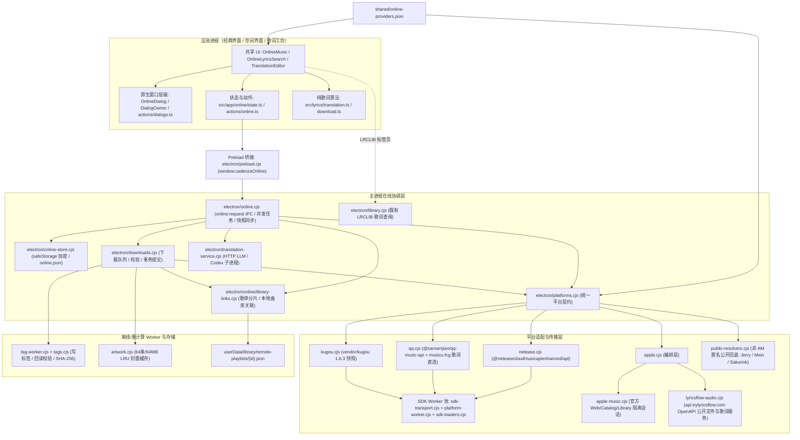
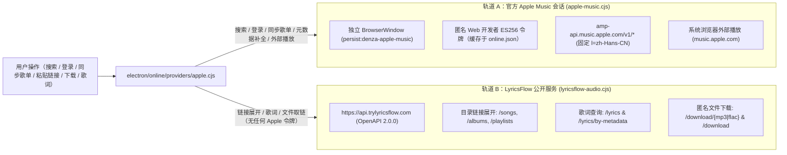
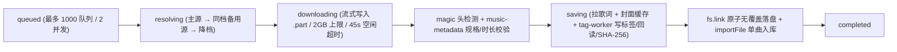

# Denza-Fork 在线 API 与关联功能架构文档

> **基线版本**：`v3.2.9-denza.10`（`custom` 分支）  
> **适用对象**：后续接手维护 Denza-Fork 在线模块的开发者，以及需要参考本项目在线 API 分层、协议适配、歌词/下载/翻译管线的读者。  
> **文档范围**：仅覆盖**在线 API 及与其直接关联的功能**（多平台搜索与账号登录、同步歌单、下载队列与写标签、在线歌词搜索/多轨解析、在线歌词翻译、前端双界面接入）。Cadenza 主程序的本地音频播放、WASAPI Hi-Fi、节奏神经网络与 3D 空间渲染见主文档与 `docs/DENZA-ARCHITECTURE.md`。

---

## 0. 核心设计原则与边界声明

1. **独立维护与协议隔离**：下载、账号歌单、在线歌词匹配与翻译均由 Denza-Fork 自行开发维护，不依赖早期参考应用（Sonora、SyncC、LyricsFlow Downloader）的后续版本或提交。底层平台 SDK 全部在 `electron/online/sdk-loaders.cjs` 中集中加载，协议响应字段止步于对应适配器，不扩散到下载队列、音乐库或 React 视图。
2. **单一真相源**：
   - 平台能力清单：`shared/online-providers.json`（同时驱动主进程注册表、前端 UI 与打包校验）。
   - 依赖版本与来源：`package.json` + `package-lock.json` 为精确版本依据，`docs/online-dependencies.json` 记录上游来源、适配文件与 vendor/源码 SHA-256 指纹。
3. **程序本身不涉及任何音频/DRM 解密**：
   - Denza-Fork 是纯协议客户端，**不包含 FairPlay 解密、Widevine CDM、密钥提取或任何受保护音频格式（如 QMC/NCM/KGM/M4P）的本地解密算法**。
   - Apple Music 的歌曲/专辑/歌单链接解析、歌词查询与匿名文件下载来自第三方公开 HTTP 服务 **`https://api.trylyricsflow.com/`**（依据其公开 OpenAPI，当前观测版本 `2.0.0`），客户端仅构造标准 HTTP 请求并对返回音频做容器/编码/时长校验；Apple 账号凭据绝不外传给该服务。
   - 仓库中唯一的格式解码辅助模块 `electron/online/qq-lyric-codec.cjs`（及 `electron/online/vendor/lrc-get/des-helper.cjs`）仅用于解包 QQ 音乐公开的 QRC 歌词文本编码，不涉及账号密钥或音频内容解密。
4. **严格区分“当前已实现”与“未来规划/备忘”**：第 1–5 节全部对应仓库现有运行代码；第 6 节明确标注为**尚未实现的后续规划与中立生态备忘**。

---

## 1. 在线子系统全景架构



### 架构边界不变量（自动化测试强制守卫）

`tests/unit/online-architecture.test.ts` 对以下边界做了静态与契约校验，后续接手修改时应保持：

- `electron/online/sdk-loaders.cjs` 是唯一允许 `require`/`import` 第三方平台 SDK（`@neteasecloudmusicapienhanced/api`、`@sansenjian/qq-music-api/services`、`kugoumusicapi`）的文件。
- `electron/online/providers/*.cjs` 禁止引用 `library.cjs`、`downloads.cjs`、`translation-service.cjs`、`main.cjs` 或任何前端 `src/app` 文件。
- `src/app/online/state.ts` 禁止依赖播放器 `playback/` 模块；播放协调统一收口在 `src/app/actions/online.ts`。
- `src/app/ui/OnlineMusic.tsx` 禁止硬编码判断 `platform === 'apple'`，平台差异必须通过 `shared/online-providers.json` 的能力字段驱动。
- `package.json` 的 `build.files` 必须包含 `shared/**`、`vendor/kugou/**`、`electron/**`（含构建生成的 `electron/generated/lyrics.cjs`），并将 `@openai/codex*` 放入 `asarUnpack`。

---

## 2. 项目文件整理与模块清单

### 2.1 共享能力声明、构建脚本与依赖治理

| 文件路径 | 职责说明 |
| --- | --- |
| `shared/online-providers.json` | 四平台（`netease`/`qq`/`kugou`/`apple`）的 ID、名称、登录方式（`qr`/`browser`）、能力开关（`download`/`lyrics`/`remotePlayback`/`credentialImport`）、文案键与 AM 音质格式标签。 |
| `docs/online-dependencies.json` | 登记全部 11 项在线相关上游依赖（npm 包、vendor 快照、公开 HTTP 协议、第三方源码片段）的仓库/文档地址、适配模块与 SHA-256 指纹。 |
| `scripts/online-deps.mjs` | 只读依赖核验工具：`npm run online:deps` 核对锁文件与 vendor/源码指纹；`npm run online:deps:check` 额外查询 npm 最新版本；`--fingerprint` 计算 `vendor/kugou` 指纹。 |
| `scripts/online-lyrics.mjs` | 通过 Vite 将 `src/lyrics/download.ts` 编译为 CommonJS 模块 `electron/generated/lyrics.cjs`，让主进程直接复用前端纯歌词解析器，避免维护第二套 TTML/LRC 解析器。 |
| `package.json` | 精确锁定在线依赖版本、脚本入口（`build:online`、`pretest`、`online:deps`）以及 `electron-builder` 打包与体积裁剪规则（排除 SDK 自带文档、示例站点和跨平台二进制）。 |

### 2.2 主进程核心协调与持久化

| 文件路径 | 职责说明 |
| --- | --- |
| `electron/main.cjs` | 桌面主进程入口，创建窗口与曲库后调用 `online.start(ipcMain, getWin, library)`，应用退出前调用 `online.close()` 回收 Worker、落盘状态与清理子进程。 |
| `electron/preload.cjs` | 通过 `contextBridge` 暴露 `window.cadenzaOnline`（`request`、`onChanged`、`onProgress`），以及既有曲库的 `window.cadenzaLib.searchLyrics`（LRCLIB）。 |
| `electron/online.cjs` | 在线子系统组装与 IPC 网关：注册 `online:request` 白名单操作、管理可取消任务池（上限 3 并发）、维护 2000 首搜索/同步候选 LRU、以并发度 4 和完整分页守卫（`collectPages`）同步账号歌单。 |
| `electron/online-store.cjs` | 持久化 `userData/online.json`：基于 Electron `safeStorage` 加密账号 Cookie 与翻译 API Key（拒绝明文/`basic_text`），提供内存明文缓存、防抖合并落盘 `scheduleSave`、原子写盘（`0o600` 临时文件 + `rename`）。 |
| `electron/platforms.cjs` | 面向应用层的统一平台契约 `Platforms`：封装 `search`、`account`、`login`（二维码会话上限 6 个 / 180s TTL）、`logout`、`page`、`resolve`（非 AM 自动回退）、`lookup`、`lyrics`（统一空行清理与多轨构建）、`open`。 |

### 2.3 平台 SDK Worker 与四平台适配器

| 文件路径 | 职责说明 |
| --- | --- |
| `electron/online/sdk-transport.cjs` | 按平台复用的 `worker_threads` 池：空闲 60s 自动销毁（`.unref()`）、单请求 25s 超时、连续 4 次挂起超时熔断重建、支持 `AbortSignal` 与 `unwrap()` 协议错误统一解包。 |
| `electron/platform-worker.cjs` | Worker 线程入口：懒加载对应平台 SDK、静默调试日志、为非 QQ 平台透传 `HTTPS_PROXY`/`HTTP_PROXY`、对异常消息脱敏防止泄露含凭据的请求 URL。 |
| `electron/online/sdk-loaders.cjs` | 唯一导入平台 SDK 的位置（`netease` / `qq` / `kugou`）。 |
| `electron/online/providers/index.cjs` | 读取 `shared/online-providers.json` 并按平台 ID 装配 4 个适配器工厂。 |
| `electron/online/providers/helpers.cjs` | 通用字段提取、Cookie 拼接、封面 URL 规范化、标准 `OnlineSong` 与分页映射、`downloadResult()` 直链校验（拒绝试听片段 `trial`/`freeTrialInfo`/`free_part=1`）。 |
| `electron/online/providers/netease.cjs` | 网易云音乐适配器（搜索、扫码/Cookie 登录、歌单分页、音质取链及降级、YRC/LRC 多轨歌词）。 |
| `electron/online/providers/qq.cjs` | QQ 音乐适配器（搜索、扫码/Cookie 登录、歌单分页、音频取链、`musicu.fcg` QRC 歌词直连 + SDK `getLyric` 回退）。 |
| `electron/online/providers/kugou.cjs` | 酷狗音乐适配器（设备 `dfid` 注册持久化、搜索、扫码/Cookie 登录、私有/公开歌单分页回退、取链、KRC/LRC 歌词）。 |
| `electron/online/providers/apple.cjs` | Apple Music 编排适配器：将搜索/登录/歌单/外部播放委托给 `apple-music.cjs`，将链接展开/歌词/音频取链委托给 `lyricsflow-audio.cjs`，并对展开的链接做 15s 超时限定的简体中文目录元数据补全。 |
| `vendor/kugou/` | 固定的第三方源码快照（`MakcRe/KuGouMusicApi` `1.6.3`，含 2 个加密签名 `.wasm` 模块），以 `file:vendor/kugou` 安装并做目录 SHA-256 指纹校验。 |

### 2.4 Apple Music 独立会话、公开文件服务与匿名网络工具

| 文件路径 | 职责说明 |
| --- | --- |
| `electron/apple-music.cjs` | Apple Music 官方 Web / Catalog / Library 客户端：隔离 `persist:denza-apple-music` 会话、导航域名白名单、匿名开发者 ES256 令牌提取与缓存、固定简体中文元数据语言 `zh-Hans-CN`、`localizeSongs` 批量补全、官方浏览器播放。 |
| `electron/online/lyricsflow-audio.cjs` | `https://api.trylyricsflow.com` 公开 HTTP 客户端（对应 OpenAPI 2.0.0）：处理 AM 链接目录展开、`/lyrics` 与 `/lyrics/by-metadata` 歌词查询、MP3/AAC/FLAC/ALAC 匿名文件请求 URL 构造。 |
| `electron/online/public-resolvers.cjs` | 非 Apple 平台的匿名公开音频回退链路（`JerryMusicAPI` → `Mxin` → `Sakurink`），严格不携带任何账号凭据。 |
| `electron/online/json-client.cjs` | 通用匿名 JSON 请求器（`credentials: 'omit'`、20s 超时、4 MB 响应上限）。 |
| `electron/online/http-files.cjs` | 匿名流式文件下载传输层（支持 HTTP/HTTPS 最多 5 次重定向、禁止 HTTPS 降级为 HTTP、支持取消、不转发 Cookie/Bearer）。 |
| `electron/online/artwork.cjs` | 匿名封面下载与内存 LRU 缓存（64 条 / 64 MB、并发请求去重、12s 超时、8 MB 上限、限制白名单音乐 CDN 域名重定向）。 |

### 2.5 下载队列、标签事务与音乐库桥接

| 文件路径 | 职责说明 |
| --- | --- |
| `electron/downloads.cjs` | 下载队列状态机与调度器（2 并发、音频 magic 字节判断、实测规格与音质降档、同档位备用源重试、暂存文件与 `fs.link` 原子无覆盖落盘、中断入库恢复）。 |
| `electron/online/audio-validation.cjs` | 针对声明了 `expectedFormat` 的音频响应（主要用于 AM 公开文件服务）校对文件扩展名、实际解码器（MP3/FLAC/AAC/ALAC）与完整时长（防止返回截断或试听片段）。 |
| `electron/online/tags.cjs` | 使用 `node-taglib-sharp` 写入标题/歌手/专辑/封面，并按容器分别写入标准 LRC 与原生 TTML 字段（FLAC/OGG/OPUS Xiph `TTML`、MP3 ID3v2 `TXXX:TTML`、M4A `com.apple.iTunes:TTML`），再配合 `music-metadata` 回读核验。 |
| `electron/online/tag-worker.cjs` | 独立 `worker_threads`（空闲 45s 自动回收）：在主线程外执行暂存复制、写标签、回读校验、时长比对与最终 SHA-256 计算；若写标签失败自动清理副本并回退保留原始已验证音频。 |
| `electron/online/library-links.cjs` | 在线模块与 Cadenza 本地曲库的唯一桥接层：同步歌单冷热分片读写（`remote-playlists/<id>.json`）、下载后单曲直入库（`importFile`）、平台源 ID 与归一化元数据 O(1) 本地曲目匹配、歌单封面并发缓存。 |
| `electron/library.cjs` | Cadenza 原音乐库模块：保留最小接入点（挂载 `library-links.cjs`、同步歌单写保护、单曲 `importFile`）；此外第 846–921 行保留 Cadenza 原生的 **LRCLIB**（`lrclib.net`）歌词搜索、MusicBrainz 标签与封面查询。 |

### 2.6 歌词格式化与在线翻译

| 文件路径 | 职责说明 |
| --- | --- |
| `electron/online/lyric-formats.cjs` | 将网易云 YRC、酷狗 KRC 逐字时间及酷狗 Base64 `language` 附轨统一映射为 Cadenza 增强 LRC 语法（`[mm:ss.xxx]<mm:ss.xxx>词`）。 |
| `electron/online/qq-lyric-codec.cjs` | 解包 QQ 音乐 `musicu.fcg` 返回的十六进制编码 QRC/翻译/罗马音歌词并转为增强 LRC（使用公开格式常量，不涉及账号或音频加密）。 |
| `electron/online/vendor/lrc-get/` | 固定来源自 `valenbine/LRC-GET`（MIT，commit `2cc0e67d`）的 `des-helper.cjs`，供 `qq-lyric-codec.cjs` 使用。 |
| `src/lyrics/download.ts` | 纯函数模块（构建产物为 `electron/generated/lyrics.cjs`）：按数值时间戳与“原词 → 译文 → 读音”明确顺序交错合并多轨 LRC；保持原生 TTML 不被 LRC 伪造。 |
| `src/lyrics/translation.ts` | 纯歌词匹配与译文草稿合并逻辑（经 `src/engine` 暴露给前端）：识别无角色 LRC 中的读音行以防误删、`cleanBlankLyricRows` 清理空白行、解析粘贴稿并做时间/原文/顺序匹配。 |
| `electron/translation-service.cjs` | 主进程翻译服务：`Translator`（OpenAI Responses/Chat、DeepSeek、OpenAI 兼容接口）与 `CodexText`（隔离沙箱运行 `@openai/codex` app-server，禁用全部工具与写权限，强制 JSON Schema 整行译文输出）。 |

### 2.7 渲染端状态、动作与双界面共享 UI

| 文件路径 | 职责说明 |
| --- | --- |
| `src/app/bridge.ts` | 前端与 Preload 之间的类型化桥接，导出 `Online`（`window.cadenzaOnline`）、`Lib`（含 `searchLyrics`）及 `Playlist.remote` 类型定义。 |
| `src/app/online/types.ts` | 从 `shared/online-providers.json` 导出 `MUSIC_PLATFORMS`、`platformInfo()` 及 `OnlineSong`、`DownloadJob`、`OnlineLyrics`、`TranslationProvider` 等共享 TypeScript 类型。 |
| `src/app/online/state.ts` | 共享在线状态 `online` store、`bootOnline()`（订阅 `online:changed` 与增量 `online:progress`）、统一请求封装 `request()` 与 `jobId()`。 |
| `src/app/online/words.ts` | 注册在线功能的多语言文案补丁。 |
| `src/app/actions/online.ts` | 应用层动作协调：`openRemote()` 打开远端官方播放页后暂停 Cadenza 本地播放引擎。 |
| `src/app/actions/dialogs.ts` / `src/app/ui/DialogOwner.tsx` / `src/app/ui/OnlineDialog.tsx` | 扩展弹窗原生层级、互斥焦点陷阱与草稿恢复机制（避免仅靠独立 portal 堆叠覆盖原生面板）。 |
| `src/app/ui/OnlineMusic.tsx` / `OnlineMusic.module.css` | 经典与空间共用的在线音乐主面板（多平台搜索、AM 链接粘贴、下载队列管理、平台账号扫码/导入、同步歌单视图）。 |
| `src/app/ui/OnlineLyricsSearch.tsx` | 经典与空间歌词编辑器共用的完整歌词搜索器（“多平台”与既有 “LRCLIB” 双来源切换，预览并应用完整多轨歌词）。 |
| `src/app/ui/TranslationEditor.tsx` | 经典、空间与歌词工坊三处共用的“翻译与匹配”双栏编辑器（在线大模型/Codex 翻译、粘贴匹配、多平台译文参考、逐行锁定与合入草稿）。 |
| `src/app/ui/OnlineSurface.ts` / `OnlineSurface.module.css` / `PlatformArtwork.tsx` | 经典纸面浮层与空间玻璃卡片的适配样式，以及四个平台的纯原创几何 SVG 图标。 |
| `src/app/space/SpaceShell.tsx` / `SpaceShell.module.css` / `SpaceDetail.tsx` / `SpacePanels.tsx` / `playlistRoom.ts` | 空间模式接入点：左上角独立「在线」按钮槽位（`.onlineControl`）、单个 `SpaceView` 互斥面板、3D 歌单房间的同步歌单分类与远端曲目视图。 |

### 2.8 在线测试套件

| 测试文件 | 覆盖范围 |
| --- | --- |
| `tests/unit/online-architecture.test.ts` | 能力清单一致性、模块导入隔离守卫、三平台 SDK 适配器契约（搜索/分页/音质/歌词/试听拒绝）。 |
| `tests/unit/online.test.ts` | 凭据加密、分页快照、下载状态机与校验、歌词合并与翻译匹配、曲库关联与冷热分片等核心单测。 |
| `tests/unit/online-fixes.test.ts` | 音质回退、酷狗歌单回退、空行清理、封面缓存等回归测试。 |
| `tests/unit/online-space.test.ts` | 空间同步歌单统计、分类模型与窗口互斥单测。 |
| `tests/unit/apple-music.test.ts` | Apple Music 令牌缓存、导航白名单、`zh-Hans-CN` 元数据、分页与重定向守卫测试。 |
| `tests/unit/lyricsflow-audio.test.ts` | `LyricsFlowAudio` 链接解析、分页校验、歌词回退、音频 URL 构造与格式校验测试。 |
| `tests/online-desktop.cjs` / `tests/online-space-desktop.cjs` | Playwright 浏览器模拟流程（经典与空间模式下的搜索、下载、歌词匹配、翻译草稿，使用模拟提供者）。 |
| `tests/online-electron.cjs` | 真实 Electron 主进程集成测试（受限 IPC、真实 `OnlineStore`、合成曲库、官方 Codex 运行时生命周期）。 |

---

## 3. IPC 契约、状态推送与持久化模型

### 3.1 IPC 通道与安全守卫

渲染器仅通过 `window.cadenzaOnline` 访问在线后端：

- `request(operation, args)` → `ipcRenderer.invoke('online:request', operation, args)`
- `onChanged(cb)` ← 主进程推送完整状态快照 `online:changed`（`accounts`、`folder`、`preferences`、`jobs`）
- `onProgress(cb)` ← 下载流式传输期间每 >350ms 推送增量 `{ id, status, received, total }`，避免高频全量序列化整张任务表

`electron/online.cjs` 在入口处强制校验：
1. `event.sender === getWin()?.webContents`（仅允许主窗口调用）；
2. `Object.hasOwn(operations, operation)`（严格白名单）；
3. `JSON.stringify(args).length <= 200000`（防止超大载荷）；
4. 耗时网络操作通过 `job(jobId, run)` 纳入可取消任务池（ID 符合 `^[a-zA-Z0-9-]{1,80}$`，同时最多 3 个并发任务）。

### 3.2 `online:request` 全量操作列表

| Operation | 关键参数 | 可取消 (`jobId`) | 说明 |
| --- | --- | --- | --- |
| `state` | 无 | 否 | 返回初始 `{ accounts, folder, jobs, preferences }`（不含任何密文或 Cookie）。 |
| `preferences` | `{ platform?, quality?, lyricsMode? }` | 否 | 保存按平台划分的音质偏好或全局内嵌歌词字段模式（`both`/`lrc`/`ttml`/`none`）。 |
| `folder` | 无 | 否 | 弹出原生目录选择框并保存下载目录。 |
| `search` | `{ platform, query, page, jobId }` | 是 | 单平台或 `'all'` 并发搜索（`Promise.allSettled` 局部容错，返回 `tracks` 与 `errors`），结果写入 2000 曲目 `candidates` 缓存。 |
| `lookup` | `{ input, jobId }` | 是 | 解析 Apple Music 歌曲/专辑/公开歌单链接或目录 ID，并补全简体中文元数据。 |
| `login` | `{ platform, action, sessionId? }` | 否 | `create` / `poll` / `cancel` 登录流程（二维码会话或 AM 浏览器登录窗口）。 |
| `account` | `{ platform, cookie, uid? }` | 否 | 手动导入并校验平台凭据（仅 `credentialImport: true` 的平台支持）。 |
| `logout` | `{ platform }` | 否 | 清除账号、作废会话（AM 同步清空专用 Chromium 分区存储）。 |
| `sync` | `{ platform, jobId }` | 是 | 拉取全量歌单列表（上限 300 张）并以并发度 4 经 `collectPages()`（单歌单上限 100 页、检测分页停滞/缺失/账号切换）原子更新本地同步歌单。 |
| `enqueue` | `{ keys, quality }` | 否 | 将 1–100 首候选/同步曲目加入下载队列。 |
| `downloadAction` | `{ id, action }` | 否 | 对下载任务执行 `pause` / `cancel` / `retry` / `remove`（`saving` 阶段拒绝修改）。 |
| `openRemote` | `{ key?, playlistId? }` | 否 | 打开支持远端播放平台（当前为 Apple Music）的官方播放页面。 |
| `appleOpen` | `{ key?, playlistId? }` | 否 | 首版兼容别名，新调用方应使用 `openRemote`。 |
| `playlistCover` | `{ id }` | 否 | 触发并缓存同步歌单原封面到 Cadenza 本地封面目录（并发上限 4，同 URL 去重）。 |
| `playlistSongs` | `{ id }` | 否 | 按需从分片读取某张同步歌单的完整远端曲目数组（含匹配到的 `localId`）。 |
| `lyrics` | `{ key, jobId }` | 是 | 拉取并归一化单曲完整多轨歌词（原词、译文、读音、合成 LRC、原生 TTML）。 |
| `provider` | 无 | 否 | 返回翻译提供者公开配置（`kind`/`baseURL`/`protocol`/`model`/`hasKey`）。 |
| `setProvider` | `{ kind, baseURL, protocol, model, key? }` | 否 | 校验并保存翻译服务配置，API Key 经 `safeStorage` 加密存储。 |
| `models` | 无 | 否 | 拉取当前翻译提供者可用模型列表（OpenAI 兼容 `/models` 或 Codex `model/list`）。 |
| `codex` | `{ action }` | 否 | 管理 Codex OAuth 登录状态（`status`/`login`/`cancel`/`logout`）。 |
| `translate` | `{ input, jobId }` | 是 | 执行整曲结构化逐行歌词翻译。 |
| `cancel` | `{ jobId }` | 否 | 中止指定进行中的在线任务。 |

### 3.3 持久化与冷热分片

1. **凭据与状态文件：`userData/online.json`**（由 `electron/online-store.cjs` 管理）
   - 顶层结构：`{ accounts, provider, jobs, folder, device, preferences, appleTokens }`。
   - **安全约束**：所有账号 Cookie（`accounts[p].secret`）与翻译 API Key（`provider.secret`）均通过 Electron `safeStorage.encryptString()` 转为 Base64 密文存储；若系统加密不可用或退化为 `basic_text`，直接报错拒绝明文落盘。
   - 内存明文缓存 `this.decrypted` 避免重复调用系统钥匙串，在 `load()`、`deleteAccount()`、`clearCache()` 与 `close()` 时清空；文件以 `0o600` 权限临时写入后原子 `rename`，若启动读取损坏则报错并保留原文件不覆盖。
2. **同步歌单冷热分片：`userData/library/remote-playlists/<playlistId>.json`**（由 `electron/online/library-links.cjs` 管理）
   - Cadenza 主库 `db.json` 与 `lib:changed` 仅保留同步歌单的摘要元数据（`platform`、`uid`、`id`、`artworkUrl`、`cover`、`updated`、`songCount`）与已匹配的本地 `tracks: string[]`，完整远端歌曲列表按歌单 ID 单独异步串行原子写盘。
   - 启动时自动迁移早期内联在 `db.json` 中的旧同步歌单（`migrateLegacyPlaylists()`）。
   - 本地曲目关联遵循“精确优先、无歧义次之”：先按 `onlineKey`（`<platform>:<id>`）和 `onlineCatalogKey`（`<platform>:catalog:<catalogId>`）精确匹配（同源多音质优先保留已有绑定，否则按无损 → 采样率 → 位深择优）；否则按 NFKC 归一化 `title + artist` 且时长差 <2s 的**唯一**本地曲目匹配。

---

## 4. 四大音乐平台 API 接入详解

### 4.1 当前在线依赖与协议总表

> 精确版本以 `package.json` 与 `package-lock.json` 为准，来源登记见 `docs/online-dependencies.json`。

| ID | 类型 | 当前版本 / 指纹 | 上游来源 | 许可 | 适配模块 |
| --- | --- | --- | --- | --- | --- |
| `@neteasecloudmusicapienhanced/api` | npm | `4.41.1` | `github.com/NeteaseCloudMusicApiEnhanced/api-enhanced` | MIT | `electron/online/providers/netease.cjs` |
| `@sansenjian/qq-music-api` | npm | `2.6.0` | `github.com/sansenjian/qq-music-api` | MIT | `electron/online/providers/qq.cjs` |
| `kugoumusicapi` | vendor | `1.6.3` (`vendor/kugou`) | `github.com/MakcRe/KuGouMusicApi` | MIT | `electron/online/providers/kugou.cjs` |
| `lrc-get-online-lyric-helper` | source | commit `2cc0e67d` (`src/des-helper.js`) | `github.com/valenbine/LRC-GET` | MIT | `electron/online/qq-lyric-codec.cjs` |
| `apple-web` | protocol | 无固定版本 | Apple Music API 文档 / Web Player | 官方服务协议 | `electron/apple-music.cjs` |
| `lyricsflow-file-service` | protocol | OpenAPI 观测 `2.0.0` | `https://api.trylyricsflow.com/openapi.json` | 第三方公开服务 | `electron/online/lyricsflow-audio.cjs` |
| `jerry-music` | protocol | 无固定版本 | `https://music-api.jerrynis.com` | 第三方公开服务 | `electron/online/public-resolvers.cjs` |
| `mxin-music` | protocol | 无固定版本 | `https://api.mxin.me` | 第三方公开服务 | `electron/online/public-resolvers.cjs` |
| `sakurink-meting` | protocol | 无固定版本 | `https://apivc-meting.sakurink.eu.org/registration/` | 第三方公开服务 | `electron/online/public-resolvers.cjs` |
| `@openai/codex` | npm | `0.169.0` | `github.com/openai/codex` | Apache-2.0 | `electron/translation-service.cjs` |
| `translation-http` | protocol | OpenAI Responses/Chat | `platform.openai.com/docs/api-reference` | 兼容协议 | `electron/translation-service.cjs` |

### 4.2 进程内 SDK Worker 池（`sdk-transport.cjs`）

网易云、QQ、酷狗三个平台的 Node.js SDK 均运行在独立的 `worker_threads` 中：

- **按平台单实例复用**：每个平台维护一个常驻 Worker 槽位，避免反复冷启动加载大型 SDK 模块；队列空闲 **60 秒**后自动 `.unref()` 并终止释放内存。
- **超时与熔断**：单次 SDK 请求超时 **25 秒**；若同一 Worker 累计挂起超时达到 **4 次**（`MAX_HUNG_REQUESTS = 4`）且无其他活跃请求，直接销毁重建，防止僵死连接拖垮后续请求。
- **安全与错误脱敏**：`platform-worker.cjs` 捕获 SDK 异常时只返回 `Platform request failed (<platform>/<method>)`，绝不向主进程或 UI 透出可能带 Cookie/Token 的原始请求 URL；`unwrap()` 统一识别 HTTP ≥400、`isOk === false`、`status === 0` 或非成功业务码（允许 `0/1/200/800/801/802/803`）。

### 4.3 网易云音乐（`electron/online/providers/netease.cjs`）

- **底层来源**：`@neteasecloudmusicapienhanced/api` (`4.41.1`)。
- **核心映射**：
  - 搜索：`cloudsearch`（`type: 1, limit: 30`）。
  - 登录与校验：`login_qr_key` + 本地 `qrcode` 渲染 DataURL → `login_qr_check`（`800` 过期、`803` 成功）；校验走 `login_status`。
  - 歌单分页：`user_playlist`（列表）与 `playlist_track_all`（歌曲，每页 100）。
  - 音频取链：优先 `song_url_v1`（`standard` / `exhigh` / `lossless` / `hires`），失败自动回退 `song_download_url`（`128000` / `320000` / `999000` / `1999000`）；均经 `downloadResult()` 剔除 `freeTrialInfo`。
  - 歌词：优先 `lyric_new`（若含 `yrc.lyric` 则经 `timedLrc(..., 'yrc')` 转为逐字 LRC，附带 `ytlrc`/`tlyric` 与 `yromalrc`/`romalrc`），为空时回退旧版 `lyric`。

### 4.4 QQ 音乐（`electron/online/providers/qq.cjs`）

- **底层来源**：`@sansenjian/qq-music-api` (`2.6.0`) + 直接 HTTP POST `https://u.y.qq.com/cgi-bin/musicu.fcg`（仅歌词快路径）。
- **核心映射**：
  - 搜索：`getSearchByKey`（`t: 0, n: 30`）。
  - 登录与校验：`getQQLoginQr` / `checkQQLoginQr`；校验走 `getUserDetail`。
  - 歌单分页：`getUserPlaylists` 与 `songListDetail`（每页 100）。
  - 音频取链：`getMusicPlay`（映射 `128` / `320` / `flac`，下载头附带 `Referer: https://y.qq.com/`）。**原生 `hires` 档位直接抛出不可用**，由上层逻辑尝试公开回退源或自动降档。
  - 歌词（双路径）：
    1. **直连快路径**：匿名 POST `https://u.y.qq.com/cgi-bin/musicu.fcg`（模块 `music.musichallSong.PlayLyricInfo`，方法 `GetPlayLyricInfo`，8s 超时，请求原词/翻译/罗马音），经 `qq-lyric-codec.cjs` 的 `decodeOnlineLyric` + `qrcLrc` 解包十六进制编码歌词并转为逐字 LRC；
    2. **SDK 回退**：若直连未取得主歌词，再调用 SDK `getLyric` 并用 `decodeText`（Base64 自动识别）兜底。

### 4.5 酷狗音乐（`electron/online/providers/kugou.cjs`）

- **底层来源**：`vendor/kugou`（`MakcRe/KuGouMusicApi` `1.6.3` 源码快照）。
- **设备注册**：首次请求自动生成随机 `KUGOU_API_MID`/`KUGOU_API_GUID`，调用 `register_dev` 取得 `dfid` 并持久化到 `online.json` 的 `device` 字段，后续请求作为 Cookie 对象一并传入。
- **核心映射**：
  - 搜索：`search`（`type: 'song', pagesize: 30`）。
  - 登录与校验：`login_qr_key` + `qrcode` 生成 `h5.kugou.com` 扫码链接 → `login_qr_check`（`status: 0` 过期、`4` 成功）；校验走 `user_detail`。
  - 歌单分页：`user_playlist` 记录 `listid → global_collection_id` 映射；拉取歌曲优先用账号私有接口 `playlist_track_all_new`，失败且存在已缓存 `global_collection_id` 时才回退公开接口 `playlist_track_all`。
  - 音频取链：`song_url`（`quality: 128/320/flac/high`，强制 `free_part: 0` 拒绝试听）。
  - 歌词：`search_lyric` 取首个候选 → 优先 `lyric(fmt: 'krc', decode: true)` 经 `kugouTracks()` 提取逐字原词以及内嵌 Base64 `language` 译文/音译轨 → 失败回退 `lyric(fmt: 'lrc', decode: true)`。

### 4.6 Apple Music 双轨架构与非解密声明（重点）

Apple Music 是本项目中唯一采用**“官方账号/元数据会话 + 外部公开文件/歌词服务”彻底解耦双轨架构**的平台，两层互不调用、凭据完全物理隔离：



#### 轨道 A：Apple Music 官方 Web / Catalog / Library（`electron/apple-music.cjs`）

- **登录与会话隔离**：
  - 使用独立 Chromium 会话分区 `persist:denza-apple-music`（`sandbox: true`、`contextIsolation: true`、`nodeIntegration: false`、无应用 preload）。
  - 严格拦截 `will-navigate`、`will-redirect` 和弹窗，仅允许 `https://` 访问 `music.apple.com`、`appleid.apple.com`、`idmsa.apple.com`、`account.apple.com`。
  - 轮询读取 `media-user-token` Cookie，经 `/v1/me/storefront` 验证有效后取 SHA-256 前 24 位作为本地命名空间 `uid`，密文保存至 `OnlineStore`。退出登录时调用 `session.clearStorageData()` 清空专用分区。
- **开发者令牌与网络边界**：
  - 匿名抓取 `https://music.apple.com/us/browse` 与其前端 bundle（`/assets/index~*.js`）提取有效 ES256 开发者令牌（优先 `kid === 'WebPlayKid'`），缓存至 `online.json.appleTokens`（过期前 120s 自动刷新）。
  - `appleFetch` 手动处理最多 5 次**同源**重定向，响应上限 20 MB，且 `credentials: 'omit'`。
- **简体中文元数据策略**：
  - 所有 `/v1/` 请求强制附加 `l=zh-Hans-CN`（常量 `METADATA_LANGUAGE`）与 `Accept-Language: zh-CN,zh;q=0.9`，但不改变账号实际 `storefront`。
  - 当用户粘贴 AM 公开链接时，`apple.cjs` 先由轨道 B 展开曲目与目录 ID，再调用 `apple.localizeSongs()` 按 `storefront` 分组、每批 100 首匿名请求 `/v1/catalog/{sf}/songs?ids=...` 补全简体中文标题/歌手/专辑/封面；整个补全限定 **15 秒**超时，失败时无缝保留轨道 B 已返回曲目，不阻塞链接入口。
- **远端播放**：`play()` 直接调用 `shell.openExternal` 在系统浏览器中打开 Apple 官方页面（Electron 未内置 Widevine CDM，不由客户端直接播放受保护流）。

#### 轨道 B：LyricsFlow 公开 OpenAPI 与文件服务（`electron/online/lyricsflow-audio.cjs`）

- **服务来源**：固定指向 **`https://api.trylyricsflow.com`**，接口依据其公开 OpenAPI 文档 **`https://api.trylyricsflow.com/openapi.json`**（当前观测版本 **`2.0.0`**）对接；强制匿名（`credentials: 'omit'`），仅接受 HTTPS（及本地调试用 loopback 地址）。
- **三类接口映射**：
  1. **链接目录展开（`lookup`）**：解析 `https://music.apple.com/<sf>/{song|album|playlist}/...` 或纯数字目录 ID，请求 `/songs/{id}`、`/albums/{id}` 或 `/playlists/{id}`（`?storefront=<sf>`）；分页严格限制在同源 `/v1/catalog/<sf>/...` 路径下，总曲目上限 **2000 首**。
  2. **歌词查询（`lyrics`）**：优先请求 `/lyrics?song=<catalogId>&storefront=<sf>`；若无结果且具备标题/歌手，则回退 `/lyrics/by-metadata?title=...&artist=...&album=...&duration_ms=...&storefront=<sf>`。保留原生 TTML 原文（`/<tt[\s>]/i`）并自动抽取附带译文行。
  3. **匿名音频文件请求（`resolve`）**：四档音质直接映射为显式音频格式，不跨平台混用其他音乐源：
     - `standard` → `mp3`：`/download/mp3?song=<catalogId>&mode=apple`
     - `lossless` → `flac`：`/download/flac?song=<catalogId>&mode=apple`
     - `high` → `aac`：`/download?url=<songURL>&mode=gamdl&codec=aac&fallback=false&storefront=<sf>`（无 `sourceURL` 时使用 `song=<catalogId>`）
     - `hires` → `alac`：`/download?url=<songURL>&mode=gamdl&codec=alac&fallback=false&storefront=<sf>`
     - 返回描述包含 `transport: 'http-file'`、`headerTimeoutMs: 180000`（服务端准备最长等 3 分钟）、`expectedFormat`（交给 `audio-validation.cjs` 核对真实编码与完整时长）与 `qualityByFormat: true`（按格式校验而非按 Hi-Res 采样率门槛误杀标准采样率 ALAC）。

> [!IMPORTANT]
> **非解密与凭据零泄露边界**
> 1. **Denza-Fork 本身不执行任何音频或 DRM 解密**：应用内没有 FairPlay 逻辑、没有解密密钥、没有本地解密二进制或服务端算法。上述请求参数中的 `mode=gamdl` 仅是 `api.trylyricsflow.com` OpenAPI 定义的服务端公开查询参数，客户端只负责发送匿名 HTTP GET、流式接收文件并校验其是否为完整、格式匹配的普通音频文件。
> 2. **Apple 凭据严格隔离**：`apple-music.cjs` 与 `lyricsflow-audio.cjs` 互不引用；用户的 Apple `media-user-token`、浏览器会话 Cookie 以及翻译 API Key **永远不会**发送到 `api.trylyricsflow.com`。
> 3. 无 Apple Catalog ID 的用户自上传资料库曲目不支持通过目录下载接口获取，系统会明确报错并保留官方资料库打开入口。

### 4.7 当前匿名公开音频回退链路（`electron/online/public-resolvers.cjs`）

仅针对非 Apple 平台（`netease` / `qq` / `kugou`），当原生 SDK 取链失败、返回试听片段、或实测文件规格/时长校验失败时，`Platforms.resolve()` 按顺序匿名尝试以下公开 HTTP 端点（强制 `credentials: 'omit'`，**不发送任何平台 Cookie**，仅发送平台名、曲目 ID 与目标码率）：

1. **`JerryMusicAPI`**（仅网易云）：`https://music-api.jerrynis.com/api/song/url/v1?id=...&level=...`
2. **`Mxin`**：`https://api.mxin.me/api/v1/music?server=<platform>&type=url&id=...&bitrate=<kbps>`
3. **`Sakurink`**：`https://apivc-meting.sakurink.eu.org/registration/?server=<platform>&type=url&id=...&br=<kbps>`（302 重定向取直链，10s 超时）

> 失败追踪机制：`Downloads.run()` 会记录当前档位已尝试过的来源名列表 `excluded`，同档位优先耗尽未试过的备用源后，再按 `hires → lossless → high → standard` 逐档降级。

---

## 5. 在线关联功能全链路

### 5.1 下载队列、音质校验与标签事务（`downloads.cjs`）



关键工程细节：
- **断点与恢复策略**：暂停或退出后的任务重启会重新下载（非 HTTP Range 续传）；但若文件已落盘且 `job.pending` 记录了目标路径与 SHA-256、仅在最后 `importDownload` 阶段中断，下次重试会直接校对 SHA-256 并补做入库，不重复下载。
- **真实音频校验**：
  - 魔数头识别：`fLaC` / ADTS `aac` / `ID3` 或帧同步 `mp3` / `ftyp` (`m4a`) / `OggS` / `RIFF+WAVE`。
  - 完整时长拦截：若目标曲目 >60s 且实测时长比元数据时短超过 15s（或 `expectedFormat` 的 2%/1–5s 容差内不达标），判定为试听/残缺片段并立即删除 `.part` 文件触发回退。
  - 实测规格：界面展示真实 `codec`、`sampleRate`、`bits`、`bitrate`；对于非 `qualityByFormat` 平台，若请求 `hires` 但实测仅 `lossless` 或更低，会视为未达标并继续尝试同档备用源或显式记录降档原因。
- **后台写标签与无损回退（`tag-worker.cjs` + `tags.cjs`）**：
  - 先将验证通过的暂存音频独占复制到 `.tags.<ext>` 副本，在独立 Worker 中写入标题/歌手/专辑、LRU 缓存封面、按 `lyricsMode`（`both`/`lrc`/`ttml`/`none`）写入 LRC 与容器专属 TTML 字段，再用 `music-metadata` 回读核验字段存在且时长漂移 ≤0.05s。
  - 若写标签或回读校验任一步失败，立即删除损坏副本、**保留原始已验证音频**并附带 `metadataWarning`，绝不丢弃已下载音频。
- **零覆盖落盘与快速入库**：使用 `fs.promises.link()` 独占硬链接为 `歌手 - 歌名.ext`（重名自动追加 `(1)`…`(9999)`），随后通过 `library.importDownload()` 直接调用单曲 `importFile()` 入库并触发 `linkSyncedPlaylists()`，避免全库重扫。

### 5.2 在线歌词管线与 LRCLIB 现状

1. **多平台统一歌词输出**：
   - `Platforms.lyrics()` 调用对应平台适配器获取 `{ original, translation, pronunciation, ttml?, source? }`，先对非 TTML 文本执行 `cleanBlankLyricRows()`（清除空白行与 `//` 占位行，保留元数据与有意义提示符），再交由 `electron/generated/lyrics.cjs`（源码 `src/lyrics/download.ts`）生成最终 `lrc` 与 `ttml`。
   - **不伪造原生 TTML 原则**：只有来源本身提供真实 `<tt ...>` 文档时才填充 `ttml` 字段；纯 LRC 来源的 `ttml` 始终为空串，下载内嵌选“仅 TTML”时会如实标记为不可用。
   - 合并多轨 LRC 时按数值时间戳排序，同时间戳按明确轨道序号 **原词(0) → 译文(1) → 读音(2)** 排列并去重，同时完整保留 `<mm:ss.xxx>` 逐字时间戳。
2. **既有 LRCLIB 集成现状**：
   - Cadenza 原生在 `electron/library.cjs`（第 874–921 行）实现了针对 **`https://lrclib.net/api/get`**（精确匹配曲名/歌手/专辑/时长）与 **`https://lrclib.net/api/search`**（结构化与自由文本搜索）的三步合并查询（带重试、12s 超时、优先同步歌词和最接近时长）。
   - 当前在 `src/app/ui/OnlineLyricsSearch.tsx` 中，用户可在 **“多平台”**（走 `online:request` → 四平台）与 **“LRCLIB”**（走 `cadenzaLib.searchLyrics` → `library.cjs`）两个标签页之间手动切换；**LRCLIB 尚未接入 `Platforms.lyrics()` 自动下载内嵌歌词链路**。
   - 所有在线匹配到的歌词最终均通过 Cadenza 原生 `useLyrics` 保存链路落盘，不另起写文件入口。

### 5.3 在线翻译服务（`translation-service.cjs` + `src/lyrics/translation.ts`）

- **支持的后端**：
  - `openai`（`https://api.openai.com/v1`，默认 `responses` 协议，强制 `strict: true` JSON Schema 输出）；
  - `deepseek`（`https://api.deepseek.com`）；
  - `compatible`（任意 HTTPS 或 `localhost`/`127.0.0.1` OpenAI 兼容服务，可选 `responses` 或 `chat` 协议）；
  - `codex`（内置 `@openai/codex` `0.169.0` 官方 app-server，经 `shell.openExternal` 完成 ChatGPT OAuth 登录，白名单限定 `auth.openai.com` / `chatgpt.com`）。
- **Codex 安全沙箱隔离**：启动子进程时使用空隔离目录 `cwd`、裁剪环境变量、显式关闭 `web_search` / `mcp_servers` / `shell_tool` / `apps` / `plugins` / `multi_agent` / `view_image` / `code_mode_host`，使用 `sandbox: 'read-only'` + `ephemeral: true` + `networkAccess: false`，并在事件流中主动拦截任何工具调用企图。
- **歌词数据约束**：
  - 发送给模型的仅是剥离时间戳后的纯文本行 `{ id, text }`、歌曲信息、目标语言、用户上下文与已锁定译文（上限 1200 行 / 100 KB，响应超时 240s）。
  - 返回结果严格校验行数完全匹配、无重复 ID、无换行或时间戳注入，并交由 `src/lyrics/translation.ts` 的 `mergeTranslations()` 仅替换明确识别的译文行（尽量保护无角色 LRC 中的罗马音/假名/拼音读音附行不被误删）。

### 5.4 双界面共用与窗口层级

- 经典模式（`Library.tsx` / `Shell.tsx`）与空间模式（`SpaceShell.tsx` / `SpaceDetail.tsx` / `SpacePanels.tsx`）共用同一套 `OnlineMusic`、`OnlineLyricsSearch`、`TranslationEditor` 组件与 `online` 状态，仅通过 `useOnlineSurface()` 切换纸面/舞台与空间玻璃样式。
- 所有在线弹窗经 `OnlineDialog` → `actions/dialogs.ts` + `DialogOwner.tsx` 托管输入与焦点所有权；空间主面板统一由 `SpaceShell` 的单个 `SpaceView` 互斥切换。
- 空间模式的左上角入口按维护约定独立展示“在线”二字，位置由 `SpaceShell.module.css` 的 `.onlineControl` 槽位控制。

---

## 6. 未来演进规划与生态方向备忘

> [!WARNING]
> **现状边界声明**：本节所有内容均**尚未在当前代码中实现**。  
> - **6.1** 与 **6.2** 为明确的后续演进规划，供接手者按需排期实施；  
> - **6.3** 仅为对外部开源生态的客观记录，**不构成采用推荐，当前程序也未使用其中任何项目**。

### 6.1 规划一：歌词源补充（高质量逐字 TTML + 统一兜底源）

**当前局限**：
- 现有自动下载与在线歌词搜索依赖四大音乐平台自身接口，外语/独立/长尾曲目偶发缺词，且非 Apple 平台的逐字精度与双语/和声结构参差不齐；
- `LRCLIB` 目前仅存在于 `electron/library.cjs` 的独立标签页中，未纳入 `Platforms.lyrics()` 的统一多源编排。

**规划方向**：
1. **补充社区逐字 TTML 歌词库**：
   - 评估接入 **`amll-dev/amll-ttml-db`**（CC0-1.0，社区持续维护的逐字 TTML 歌词库，包含音节级时间轴、译文、罗马音及和声轨道）或其配套检索服务 **`amll-dev/amll-ttml-api`**（Apache-2.0）。
   - 该数据源输出原生 TTML，与 Denza-Fork 现有的 `downloadLyricFormats()`、容器 `TTML` 标签写入及双界面逐字渲染管线天然契合，无需做有损格式转换。
2. **统一并增强 `LRCLIB` 公共兜底源**：
   - 保留 `LRCLIB`（`tranxuanthang/lrclib`，MIT，`https://lrclib.net/api/*`）在手动选择器中的独立入口，同时评估将其抽象为只读辅助歌词源接入统一歌词管线，作为外语/冷门曲目在主平台缺词时的兜底来源。
   - 沿用既有底线：LRCLIB 仅提供逐行 LRC/纯文本，绝不据此伪造原生 TTML 字段。
3. **接入边界建议**：
   - 新增独立歌词提供者模块（例如 `electron/online/lyric-sources/`），由 `Platforms.lyrics()` 或上层歌词协调器按可配置优先级编排（例如：原生平台逐字/TTML → 社区 TTML 补充 → LRCLIB 兜底），**不改变** `Platforms.lyrics()` 的标准返回结构 `{ original, translation, pronunciation, lrc, ttml, source }`，也不将来源细节扩散到 `downloads.cjs`、`tags.cjs` 或前端组件。

### 6.2 规划二：QQ 音乐换源与直连补强规划

**当前局限**：
- `electron/online/providers/qq.cjs` 当前依赖 `@sansenjian/qq-music-api`（`2.6.0`），社区维护体量相对较小，且受限于上游接口覆盖，当前原生 `hires` 档位不可用；歌词部分实际上已经绕过 SDK 改为直接请求 `https://u.y.qq.com/cgi-bin/musicu.fcg`。

**规划方向**：
1. **评估替换 Node.js SDK 上游**：
   - 优先考察社区体量更大、维护更持续的 TypeScript 实现（如 **`Rain120/qq-music-api`**（MIT）及其保持更新的社区维护分支如 **`yakult-green-tea/qq-music-api`**（MIT）），对照 `qq.cjs` 所需的 7 项核心能力（`search`、扫码登录与校验、`user_playlist`、歌单歌曲分页、`getMusicPlay` 音频取链、歌词兜底）逐项做契约回归。
2. **逐步补强 `musicu.fcg` 直连路径**：
   - 可参考社区协议实现（例如 **`L-1124/QQMusicApi`**，Python / GPL-3.0——仅作为协议字段与请求结构参考，注意与本项目 `AGPL-3.0-only` 的许可合规，不直接照搬源码）逐步增强 `qq.cjs` 对官方 `musicu.fcg` 聚合网关的直连能力（如搜索、歌单详情与高音质取链），降低对单一第三方封装包的耦合。
3. **迁移隔离优势**：
   - 得益于当前分层，QQ 音乐换源理论上仅需改动 **`electron/online/sdk-loaders.cjs`**（若切换 npm 包）、**`electron/online/providers/qq.cjs`**、**`package.json`** 与 **`docs/online-dependencies.json`**，无需触碰 `platforms.cjs`、`downloads.cjs`、`library-links.cjs`、IPC 契约或前端 UI，且可直接由 `tests/unit/online-architecture.test.ts` 与 `tests/unit/online.test.ts` 验证接口一致性。

### 6.3 其他方向备忘：音频回退生态观察（未接入、不做推荐）

目前本项目针对非 Apple 平台的音频回退机制固定为 `electron/online/public-resolvers.cjs` 中的匿名公开 HTTP 端点（`JerryMusicAPI` → `Mxin` → `Sakurink`）。

为便于后续接手者了解外部生态现状，此处仅**中立记录**开源社区在“跨平台音频回退/音源解析”方向上常见的其他思路与代表项目：
- **进程内多源音源匹配库**：例如 `@unblockneteasemusic/server`（LGPL-3.0），通过在本地聚合多个外部音源匹配替代音频流；
- **可自部署统一网关**：例如 `metowolf/Meting`（MIT），由部署者自行托管多平台聚合转发接口；
- **社区第三方公共聚合接口**：例如各类公开托管的 Meting 实例或聚合 API 服务（如 GDStudio、TuneHub 等公开端点形态）。

> [!NOTE]
> **明确声明**：以上列举的各类方案与项目**均未接入当前 Denza-Fork 代码库**，本节**不做任何采用推荐或优劣背书，也不代表计划引入**。外部公共接口与音源匹配工具普遍存在可用性波动、合规风险、反爬失效与许可证约束，后续接手者如需调整音频回退策略，应独立评估安全性、合规边界、`AGPL-3.0-only` 许可兼容性与长期维护成本。

---

## 7. 接手维护速查手册（Runbook）

### 7.1 依赖核查与独立升级

```powershell
# 只读核对：检查 package.json、package-lock.json、node_modules 与 vendor/源码 SHA-256 指纹
npm run online:deps

# 额外向 npm 查询线上最新版本号（不修改任何文件）
npm run online:deps:check

# 更新 vendor/kugou 快照后，重新计算目录 SHA-256 指纹（人工审阅后再更新 docs/online-dependencies.json）
node scripts/online-deps.mjs --fingerprint
```

升级单个平台 SDK 的标准步骤：
1. 阅读目标 SDK 自身的 Release Notes 与许可证，在 `package.json` 中显式固定精确版本号（不使用模糊范围）；
2. 若响应字段或方法签名变化，**仅修改对应的 `electron/online/providers/<platform>.cjs`**（以及必要的 `sdk-loaders.cjs`）；
3. 更新 `docs/online-dependencies.json`（及 `NOTICE.md` / `licenses/`，如涉及许可变更）；
4. 重新生成主进程歌词模块并跑完契约与集成测试。

### 7.2 新增音乐平台的最小改动清单

1. 在 `shared/online-providers.json` 登记平台元数据与能力开关；
2. 在 `src/app/online/types.ts` 扩展 `MusicPlatform` 联合类型（并在 `PlatformArtwork.tsx` 补充几何图标）；
3. 新增 `electron/online/providers/<id>.cjs` 并在 `electron/online/providers/index.cjs` 注册；
4. 若使用 Node.js SDK，在 `electron/online/sdk-loaders.cjs` 增加加载项并固定依赖、补充 `docs/online-dependencies.json`；
5. 在 `tests/unit/online-architecture.test.ts` 与 `tests/unit/online.test.ts` 补充标准契约测试。

### 7.3 常用验证命令与诚实边界

```powershell
# 生成主进程共享歌词模块（vitest pretest 会自动执行）
npm run build:online

# 类型检查与代码格式检查
npm run typecheck
npm run format:check

# 全部单元测试（含在线架构、Apple Music、LyricsFlow、空间同步歌单）
npm test

# 仅运行在线相关单元测试
npx vitest run tests/unit/online-architecture.test.ts tests/unit/online.test.ts tests/unit/online-fixes.test.ts tests/unit/online-space.test.ts tests/unit/apple-music.test.ts tests/unit/lyricsflow-audio.test.ts

# 真实 Electron 主进程集成测试（使用独立临时配置与合成曲库）
node tests/online-electron.cjs

# 构建桌面渲染资源
npm run build:app
```

> **验证诚实边界**（详见 `docs/DENZA-VALIDATION.md`）：单元测试、模拟浏览器测试与离线 Electron 测试只能证明模块边界、状态机、加密存储与契约适配正确，**不能替代**真实平台会员账号取链、真人扫码/Apple 登录、ChatGPT Codex OAuth、外网 `api.trylyricsflow.com` 实测或 Windows 实机音频/文件占用回归；发布与交接记录须按实际执行范围如实声明。
